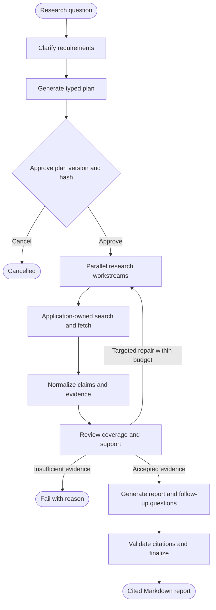

# Deep Research

[](https://github.com/pushyanthd/deep-research/actions/workflows/ci.yml)

**An evidence-backed research backend with bounded agent execution, reviewable decisions, and
measured cost.**

Deep Research turns a question into an approved research plan, parallel web investigations, an
evidence review, and a cited Markdown report. Quick mode produces a decision brief; deep mode
supports broader comparisons and targeted evidence repair. Models propose structured decisions.
Application code controls tools, budgets, state transitions, and report validation.

**[Quick report](reports/showcase/quick.md)** ·
**[Deep comparison](reports/showcase/deep.md)** ·
**[Technical brief](reports/showcase/retrieval.md)** ·
**[Engineering case study](docs/case-study.md)**

Python 3.13 · FastAPI · Pydantic v2 · OpenAI Responses API · AWS Strands Agents ·
Tavily · Playwright · DynamoDB / SQS adapters · Cognito

## See the results

The current OpenAI configuration uses GPT-5.4 mini, with more reasoning allocated to review and
reporting. These are unedited generated artifacts from the September 2026 development evaluation.

| Report | What to inspect | Generation method | Cited sources | Estimated OpenAI cost |
|---|---|---|---:|---:|
| [Quick: Samsung S90D buyer brief](reports/showcase/quick.md) | Conditional buying advice, drawbacks, and evidence gaps | Fresh end-to-end run; 4.7 minutes | 5 | $0.31 |
| [Deep: three OLED TVs compared](reports/showcase/deep.md) | Cited comparison table and recommendations by use case | Report-only replay with evidence and review held constant | 11 | $0.20 for replay |
| [Technical: retrieval architecture](reports/showcase/retrieval.md) | BM25 vs. hybrid retrieval, failure modes, and evaluation design | Re-review and rewrite of captured evidence | 4 | $0.10 for replay |

All three produced model-authored reports without fallback, unresolved citation IDs, or empty
evidence sections. In the deep writer comparison, holding evidence and review constant reduced
exact repeated paragraphs from **17 to 0** and added **three cited comparison rows**.

Replay costs exclude evidence collection. The underlying deep full run cost approximately $0.85,
including its earlier writer attempt. Estimates exclude search-provider charges. These are small
development checks, not held-out accuracy benchmarks: valid citations do not establish sentence-level
support, and comparative overstatement and semantic repetition remain areas for improvement.
See the [evaluation notes](reports/showcase/README.md) and [recorded metrics](reports/showcase/results.json).

## Engineering decisions

The core engineering problem is keeping model judgment useful while making execution inspectable,
recoverable, and bounded. The implementation separates those responsibilities at explicit boundaries.

| Concern | Implementation | Why it matters |
|---|---|---|
| Model reliability | Pydantic contracts, structured function calls, bounded repair with validation feedback | Malformed output cannot silently become application state |
| Research scope | Approval binds to the exact plan version and SHA-256 hash; workstreams have explicit question and section IDs | Execution remains tied to an inspectable plan |
| Evidence quality | Claims select captured text segments; review scores sources and rejects unsupported claims | The writer receives supporting passages and eligible claims, not just search snippets |
| Report integrity | Section-level claim permissions, citation checks for paragraphs/list items/table rows, preserved review limitations | Synthesis can reuse evidence without losing its provenance |
| Cost control | Transactional SQLite reservations before OpenAI calls; settlement from reported tokens | Concurrent local processes share a persistent spend ceiling |
| Recovery | Checkpoints, optimistic revisions, node-scoped idempotency, bounded redelivery, cooperative cancellation | Configured durable adapters support recovery across worker interruptions |
| Security boundaries | Application-owned tools, public-URL and redirect checks, tenant-scoped persistence and retrieval | Model output and fetched content do not control credentials, identity, or unrestricted tool access |

The [case study](docs/case-study.md) follows the original output failures through diagnosis,
implementation changes, and evaluation. [Output quality](docs/output-quality.md) explains the model
experiments, evidence-selection policy, cost accounting, and remaining trade-offs.

## Architecture



The FastAPI control plane manages run creation, approval, cancellation, and event polling. Workers
execute checkpointed phases; the run record is the source of truth. Research workstreams execute
in dependency waves and merge evidence using stable, content-derived IDs. OpenAI uses the Responses
API; Anthropic and Bedrock use Strands adapters behind the same typed gateway.

Evidence connects through explicit records:

```text
Captured page or PDF → verbatim excerpt → normalized claim → review → report section
                                                                       ↓
                                                        [S1] → stable source record
```

Search snippets guide discovery and cannot serve as final evidence. The writer excludes rejected
claims and claims attached to sources below the configured review threshold. Source scores are
model judgments; deterministic validation enforces the references and permissions, not factual truth.

## Execution budgets

| Mode | Time target | Search ceiling | Source ceiling | Research concurrency | Repair rounds |
|---|---:|---:|---:|---:|---:|
| `quick` | 5 min | 5 + 1 adaptive | 10 | 3 | 1 |
| `standard` | 15 min | 20 | 30 | 6 | 2 |
| `deep` | 20 min | 50 | 75 | 10 | 2 |

Application code enforces resource limits; time targets are not latency guarantees. Separately,
`OPENAI_SPEND_LIMIT_USD` defaults to **$17 across runs sharing the local ledger**. Reservations survive
restarts, and uncertain attempts retain their reservation. This ceiling covers this application's
OpenAI calls, not search charges, other providers, or unrelated API clients.

## Run locally

Requires Python 3.13, an OpenAI API key, and a Tavily API key. Anthropic and Bedrock are also
configurable through [model routing](config/models.yaml).

```bash
git clone https://github.com/pushyanthd/deep-research.git
cd deep-research
python3.13 -m venv .venv
source .venv/bin/activate
python -m pip install -e '.[dev]'
playwright install chromium
cp .env.example .env
```

Set `OPENAI_API_KEY` and `TAVILY_API_KEY` in `.env`. The example already selects OpenAI and
GPT-5.4 mini. Run an interactive research session:

```bash
deep-research-run \
  "Compare BM25 and hybrid retrieval for an internal technical documentation assistant" \
  --depth quick --output research-reports/
```

The CLI asks for missing requirements and plan approval, then saves the report. Use `--depth deep`
for a broader investigation. To expose the local API with its worker in the same process:

```bash
deep-research-dev
# API documentation: http://127.0.0.1:8000/docs
```

Local mode uses an in-memory run store and a fixed development identity. DynamoDB/SQS and Cognito
adapters are available for separately configured environments. See [development and operations](docs/development.md).

## Verification and evaluation

The deterministic suite has **185 passing tests** at this revision. CI runs lint and tests on
Python 3.13 without requiring model credentials or paid requests.

```bash
pytest
ruff check src tests
```

Coverage includes schema repair, evidence isolation, citation validation, concurrent spend
reservations, SSRF controls, cancellation, checkpoint resumption, idempotency, Cognito verification,
DynamoDB persistence, uploads, and CLI behavior.

Live evaluations are explicitly opt-in and consume API budget:

```bash
python -m deep_research.evaluation --case oled-quick --live
python -m deep_research.evaluation --case oled-deep --live
python -m deep_research.evaluation --case retrieval-quick --live
```

[Versioned cases](evals/cases.json) define the inputs and review criteria. The evaluation runner saves
reports, checkpoints, captured model outputs, token usage, and structural metrics under ignored
`research-reports/`. Frozen-evidence replays let development comparisons isolate review or writing
changes without repeating web collection. Captured requests remain local; see
[replay instructions and limitations](docs/output-quality.md#reproduce-and-inspect).

## Implementation scope

The complete local research backend is implemented and exercised end to end. DynamoDB/SQS,
Cognito, document ingestion, and OpenSearch adapters have deterministic coverage. Cloud deployment,
infrastructure as code, a web UI, S3 artifact storage, SSE, production telemetry, and load testing
remain outside the completed scope. The project does not claim a deployed production service.

The next evaluation milestone is independent sentence-level support labeling and held-out topics.
The next operational milestone is a deployed environment with telemetry and failure-injection tests.
The [implementation status](docs/implementation-status.md) distinguishes implemented adapters from
the [original AWS target architecture](arch_plan/deep-research-system-plan.md).

## Code and documentation

| Start here | What it contains |
|---|---|
| [Worker](src/deep_research/worker.py) | Phase execution, checkpoints, budgets, and failure policy |
| [Agents](src/deep_research/agents/) and [contracts](src/deep_research/contracts/) | Structured decisions, evidence review, report generation, and validation |
| [Model gateway](src/deep_research/models/gateway.py) and [spend ledger](src/deep_research/models/spend.py) | Provider routing, retries, usage accounting, and reservations |
| [Tools](src/deep_research/tools/) | Search, page/PDF capture, caching, and URL controls |
| [Persistence](src/deep_research/persistence/) and [jobs](src/deep_research/jobs/) | In-memory and DynamoDB/SQS boundaries |
| [Tests](tests/) and [evaluation runner](src/deep_research/evaluation.py) | Deterministic regression coverage and opt-in live experiments |
| [Current reports and metrics](reports/showcase/README.md) | Inspectable output, generation methods, costs, and quality limitations |
| [Engineering case study](docs/case-study.md) | Design decisions, observed failures, and the output-quality iteration |
