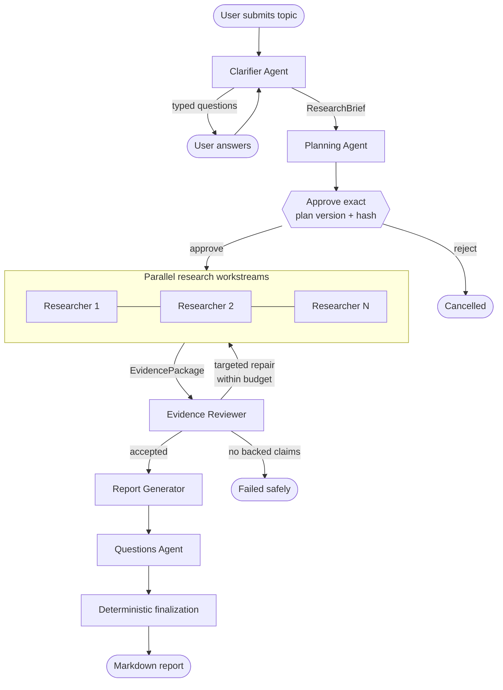

# Deep Research

[](https://github.com/FlashPD/deep-research/actions/workflows/ci.yml)

**A production-oriented, multi-agent research backend that turns an ambiguous question into a
bounded, evidence-backed Markdown report. Models propose typed decisions; application code owns
permissions, budgets, evidence provenance, durability, and publication gates.**

Python 3.13 · AWS Strands Agents · FastAPI · Pydantic v2 · Playwright · Tavily ·
Anthropic / OpenAI / Amazon Bedrock · DynamoDB / SQS adapters · Cognito JWT auth

This project is a portfolio case study in building reliable systems around probabilistic models.
It is not presented as a deployed SaaS product. The complete local workflow works end to end;
production-facing adapters are implemented for selected boundaries, while infrastructure, UI, and
operational gaps are documented explicitly in [Implementation status](docs/implementation-status.md).

## What this project demonstrates

- **Bounded agent orchestration.** Clarification, planning, research, review, reporting, and
  follow-up generation run as a deterministic graph rather than an autonomous swarm.
- **Typed model boundaries.** Every agent returns a validated Pydantic contract. Models do not
  control credentials, persistence, browser sessions, tenant identity, or budget enforcement.
- **Evidence provenance.** Search snippets are discovery metadata only. Report claims trace back
  to exact segments from pages fetched by the application.
- **Human approval before spend.** Research cannot begin until the exact plan version and SHA-256
  hash are approved.
- **Durable execution.** Phase jobs, optimistic revisions, idempotency keys, checkpoints, and
  cooperative cancellation support recovery when durable DynamoDB/SQS adapters are configured.
- **Fail-closed publication.** Invalid citations, malformed model output, unsafe diagrams, and
  unsupported claims are repaired, rejected, or deterministically degraded rather than silently
  shipped.

The repository contains approximately 9,500 lines of application code and 5,000 lines of tests.
The deterministic suite currently contains **162 passing tests**, with a separate opt-in live suite.

## Workflow



The run record is the source of truth. Each phase persists a revision and an immutable event, so
an API connection does not own execution progress. Research workstreams run in dependency waves
and merge through stable, content-derived source, excerpt, and claim IDs.

## Engineering decisions

### Agents propose; the application disposes

Agents never receive browser, search, database, or authentication tools. They produce structured
requests and decisions; application-owned adapters execute permitted operations against the
approved plan. This keeps model behavior inside enforceable security and cost boundaries.

### Evidence has a deterministic chain of custody

```text
report citation [S…]
  -> SourceRecord (canonical URL, content hash, access date)
  -> EvidenceClaim
  -> EvidenceExcerpt (verbatim text and location)
  -> CapturedMaterial fetched by the application
```

The finalizer rejects citations that do not resolve through this chain. Reviewer limitations and
unresolved contradictions are preserved in the report rather than optimized away by the writer.

### Failures are classified by whether retrying can help

Transient provider and infrastructure failures may be retried. Deterministic validation failures,
output ceilings, rejected credentials, exhausted budgets, and insufficient evidence fail fast or
take a bounded fallback path. Duplicate queue deliveries are absorbed through optimistic revisions
and node-scoped idempotency.

### Untrusted content stays data

Fetched pages, user text, upload metadata, plans, and evidence are labeled as untrusted data in
prompts. The application—not page content—owns scope, tools, identity, source budgets, and state
transitions. Browser requests also pass through URL, DNS, redirect, port, and address-space checks.

For the original system design, including the intended AWS deployment, see the unchanged
[architecture plan](arch_plan/deep-research-system-plan.md). For a precise designed-versus-built
breakdown, see [Implementation status](docs/implementation-status.md).

## Depth presets

| Preset | Target duration | Search queries | Accepted sources | Parallel workstreams | Repair rounds |
|---|---:|---:|---:|---:|---:|
| `quick` | 5 min | 5 (+1 adaptive) | 10 | 3 | 1 |
| `standard` | 15 min | 20 | 30 | 6 | 2 |
| `deep` | 20 min | 50 | 75 | 10 | 2 |

These are hard application ceilings, not suggestions left to the planner.

## Case study and raw artifacts

Two real runs are committed exactly as the CLI produced them:

| Artifact | Result |
|---|---|
| [Quick research report](reports/Quick%20research%20sample%20report.md) | 2 workstreams, 5 cited sources, 1 repair round |
| [Deep research report](reports/Deep%20research%20sample%20report.md) | 6 workstreams, 41 searches, 46 fetched sources, 225 reviewed claims, 36 cited sources |

Both runs exercised the deterministic report fallback after model-authored prose failed a hard
citation check. The raw artifacts therefore demonstrate the integrity boundary and recovery path,
but they also expose real output-quality limitations. They have not been hand-polished or
regenerated. The [portfolio case study](docs/case-study.md) analyzes what worked, what failed, the
trade-offs involved, and what changed afterward.

## Quickstart

Requires Python 3.13, a Tavily API key, and one configured model provider.

```bash
python3.13 -m venv .venv
source .venv/bin/activate
python -m pip install --upgrade pip
pip install -e '.[dev]'
playwright install chromium
cp .env.example .env
```

Populate `.env`, then verify the deterministic toolchain without making model or web requests:

```bash
pytest
ruff check src tests
```

Run the interactive local workflow:

```bash
deep-research-run "Give me a summary of Samsung's S90D TV" --depth quick --output reports/
```

Or start the local API and worker in a single process:

```bash
deep-research-dev  # http://127.0.0.1:8000
```

The local runtime uses in-memory persistence and dispatch. Configure DynamoDB and SQS to exercise
cross-process durability. Live runs consume model, search, and browser resources; they are never
part of the default test command.

## Verification

```bash
pytest            # deterministic suite; live tests excluded by default
pytest -m live    # opt-in external model, Tavily, and public-web integration tests
ruff check src tests
```

The deterministic suite covers agent validation and repair, planning constraints, evidence
merging, citation resolution, SSRF controls, page caching, cancellation, failure classification,
checkpoint resumption, budget clamping, idempotency, Cognito verification, DynamoDB persistence,
upload ingestion, and CLI behavior.

## Repository guide

```text
src/deep_research/
  agents/          typed clarifier, planner, researcher, reviewer, report, and question agents
  contracts/       Pydantic contracts for every model and application boundary
  orchestration/   bounded Strands graph topology
  services/        run lifecycle, approval hashing, idempotency, and events
  worker.py        checkpointed phase execution, budgets, cancellation, and failure policy
  persistence/     in-memory and DynamoDB repositories
  jobs/            in-memory and SQS dispatchers
  tools/           Tavily, Playwright, SSRF protection, URL normalization, and page cache
  uploads/         document parsing, quarantine/scanning, and OpenSearch retrieval
  auth/            Cognito access-token verification and local development identity
  api/             FastAPI control plane
tests/             deterministic tests plus an opt-in live suite
reports/           unedited outputs from two completed runs
```

## Documentation

- [Portfolio case study](docs/case-study.md) — design decisions, run results, failure analysis, and lessons
- [Implementation status](docs/implementation-status.md) — implemented, partial, and planned capabilities
- [Development and operations](docs/development.md) — CLI, configuration, API, testing, and troubleshooting
- [Original architecture plan](arch_plan/deep-research-system-plan.md) — full initial design and AWS target state

## Current scope

The strongest completed surface is the local end-to-end backend and its deterministic reliability
boundaries. The repository does not currently include a web UI, AWS infrastructure as code,
AgentCore deployment, S3 artifact storage, SSE streaming, or production telemetry. Those omissions
are deliberate and visible; see [Implementation status](docs/implementation-status.md) for detail.
